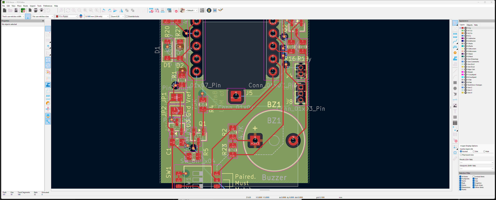

# KiCad KRGloss

KiCad KRGloss reduces and simplifies one or more already routed tracks, most
often after autorouting or manual routing. It is built on KiCad Routing Tools
by DrAndyHaas, which provides obstacle, clearance and connectivity checks.

This KiCad capture uses a medium board and runs Gloss only on the small
`D10~` track set. In the **Appearance** panel, the active copper layers and
**TrackGloss Changes** on `User.1` are visible together: the solid red routing
is the result, while the dotted overlay preserves the former path for review.

## Install

Version **0.1.4** is a **testing** release for **KiCad 10.x** (SWIG runtime).
Windows has been tested locally; Linux and macOS binaries are packaged, but
installation on those systems has not been validated for this release.

In KiCad, open **Plugin and Content Manager**, choose **Install from File…**,
select the plugin ZIP, then open **PCB Editor → Tools → External Plugins →
KiCad KRT Gloss**. Restart PCB Editor after installation or update and first
test on a copy of your board.

## Choose the scope

**Check** a net to include it; **click** a row to highlight its scope.
**Add / Replace** imports the KiCad selection; **Clear** empties the list.

With **Use elementary branches** enabled, importing a selected track remembers
its full branch, bounded by pads, free ends or junctions. **n EB** means partial
branch scope; a blank EB cell means the whole net. Without remembered branches,
checking a net selects the whole net.

If nothing is selected in KiCad, the dialog opens with no checked net. The
Gloss button remains disabled until at least one net is checked.

## Gloss

- **Stay in corridor** requires a continuous admissible movement; it is off
  by default.
- **Movable vias** allows eligible unlocked vias to move.
- **Repeat Gloss until stable** adds passes up to the G4 limit.

The G4 limit is 1–10 additional passes (1 by default). These passes are
additional to the initial time budget.

Click **Gloss**. No change is normal when no safe improvement exists.

## Review the result

The **Log** tab records the options, net names and result. The plugin also
creates or reuses **TrackGloss Changes** on a free User layer: old copper is
dashed and new copper is solid. This layer is a visual aid, not a replacement
for KiCad's visual inspection and DRC.

A known limitation remains in KRT's perpendicular via-sweep crossing check.
Review moved vias and run KiCad DRC before fabrication; G5 is not a full DRC.

Gloss modifies existing routing only. Locked or protected copper,
arcs, differential pairs and constrained tracks remain protected.

## Author and licence

**Frantz** is the author, project owner and maintainer. The project was
developed with assistance from **ChatGPT/Codex (OpenAI)**.

**DrAndyHaas** is the author and primary code provenance of
[KiCad Routing Tools (KRT)](https://github.com/drandyhaas/KiCadRoutingTools).
KiCad KRGloss is distributed under the [MIT License](LICENSE); detailed
provenance is recorded in [AUTHORS.md](docs/AUTHORS.md) and [NOTICE](NOTICE).
