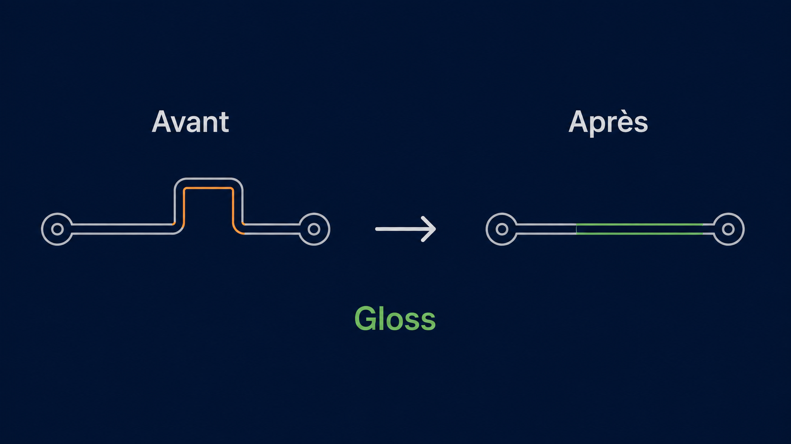

# Gloss

## Shorten and simplify

A routed track joins fixed points such as pads, vias, and junctions. It must
remain connected and respect required clearance from nearby copper.

| Action | Goal | Possible effect on length |
|---|---|---|
| Gloss | Shorten and simplify existing routing | Reduces it, or keeps it while removing an unnecessary detour |

Gloss does not freely redraw a connection. It works on existing routed copper
and only in an allowed scope. Fixed items and protected areas are anchors or
obstacles and are never moved. Every change preserves connectivity, widths,
layers, required clearances, allowed routing directions, and obstacle avoidance.

## The admissible corridor

The admissible corridor is the set of positions an item can reach through a
continuous safe movement. Free start and end positions are not sufficient:
every intermediate position must also be valid. A track, via, or junction cannot
jump to the other side of an obstacle.

## Gloss

Gloss searches for portions that can be shortened, then for equal-length shapes
using fewer segments. It reasons about relationships between neighbouring
segments, never about their on-screen orientation. Rotating or mirroring the
same shape must not change its treatment. Among valid candidates it prefers
useful length reduction, then fewer segments, then the simplest geometry.

Gloss can remove local detours, merge aligned segments, shorten a track
approach, or locally move a via or junction when that mobility is allowed. A
gain too small to distinguish from the grid is rejected.

## Result

The result is shorter, simpler, or unchanged when no admissible improvement is found.
