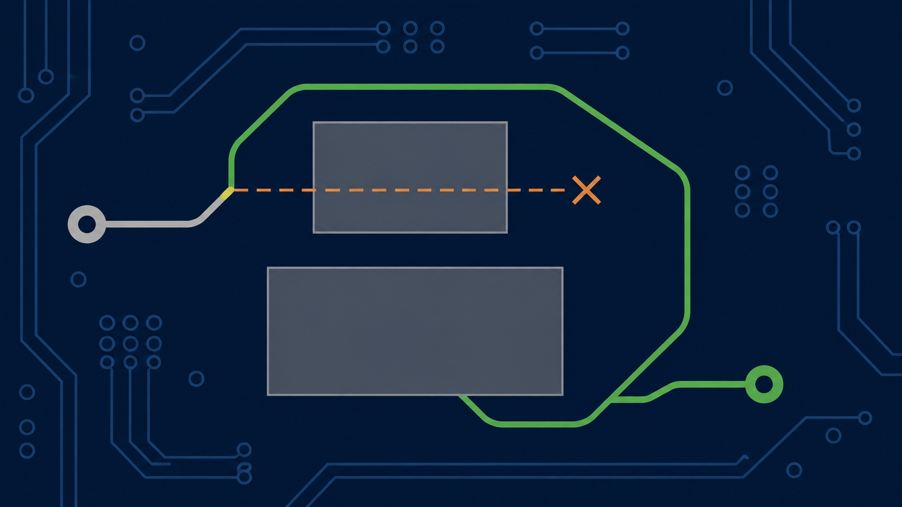
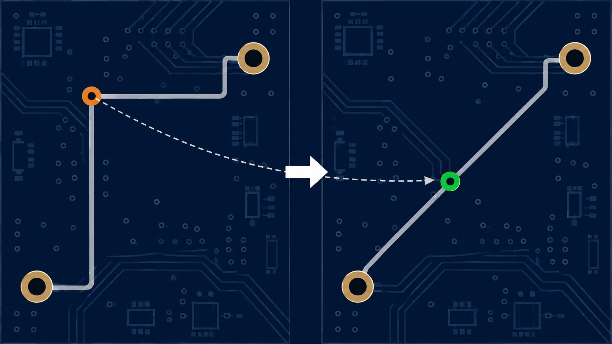

# Track Gloss — spécification de référence

Ce document fixe les règles fonctionnelles et les invariants. Pour une
présentation accessible du fonctionnement du Gloss, voir
[`gloss_explain.md`](gloss_explain.md).

## Finalité

Track Gloss est un traitement final d'un routage existant. Il améliore sa
géométrie sans effectuer d'autoroutage et sans modifier le dessin autrement
que par ce traitement final.

L'ordre impératif des objectifs est :

1. respecter les données d'entrée et toutes les règles applicables ;
2. pendant les phases de réduction, réduire la longueur avec un gain
   strictement supérieur au pas utile de la grille ;
3. à longueur équivalente, réduire le nombre de segments ;
4. conserver une sortie exclusivement octolinéaire : 0°, 45° ou 90° ;
5. ne produire ni micro-segment, ni décrochement, ni détour inutile.

La réduction de longueur peut augmenter le nombre de segments : le second
objectif ne doit pas bloquer le premier. Une destination plus courte mais
inaccessible dans le corridor ne prouve pas qu'une réduction intermédiaire est
impossible. Les raccordements entre segments doivent être examinés en plus de
leurs directions individuelles. Les transformations de vias, pads ou jonctions
peuvent rendre une nouvelle réduction locale possible ; les nets concernés sont
réexaminés avant la certification finale, indépendamment de l'activation de G4.

## Définition

- Une graine est un segment KRT explicitement désigné comme point de départ
  d'une transformation.
- Une branche élémentaire est le chemin maximal non ramifié contenant sa
  graine. Elle s'arrête à un pad, une extrémité libre ou une jonction T/X.
  Elle reste continue à travers un changement de largeur, un changement de
  couche et un via qui ne constitue pas lui-même une ramification.
- **MO3 — Éléments fixes et protégés.** Un élément fixe, verrouillé ou protégé
  conserve sa position, sa géométrie et ses attributs. Il peut servir d'ancre
  ou d'obstacle, mais aucune étape du gloss ne peut le déplacer, le remplacer
  ou le modifier. Une mobilité n'est autorisée que lorsqu'une règle la prévoit
  explicitement et que toutes ses conditions sont satisfaites.

### Corridor admissible

Un corridor admissible est l'ensemble des positions accessibles à un élément
électrique depuis sa géométrie initiale par une déformation continue qui
respecte, à chaque instant, les clearances, l'épaisseur du cuivre, la
connectivité, les ancres fixes et le périmètre modifiable.

**L'élément ne peut ni traverser un obstacle, ni le sauter pour passer d'un côté
à l'autre**, même si les géométries initiale et finale sont toutes deux valides.
Cette interdiction concerne tout le déplacement : une piste, un via mobile ou
une jonction mobile doivent la respecter avec leurs segments incidents.

Un contournement n'est admissible que s'il existe une déformation continue
entièrement autorisée. Vérifier uniquement la destination ne démontre donc pas
le respect du corridor. Le corridor n'est ni une bande de largeur fixe autour
de la piste, ni une région définie par la grille : ses limites proviennent des
obstacles et des contraintes applicables, dont KRT reste l'autorité.

Lorsqu'un certificat ne teste qu'une déformation particulière, son échec
signifie que cette déformation n'est pas certifiée ; il ne prouve pas qu'aucune
autre déformation admissible n'existe.

## Exclusion

Avant toute transformation, les nets suivants sont exclus intégralement de la
portée modifiable :

1. groupes à longueur ou temps imposé ;
2. paires différentielles couplées ;
3. nets avec contrainte d'impédance ;
4. nets contenant du cuivre verrouillé, piste ou via ;
5. nets contenant des arcs.

Ces exclusions restent des obstacles pour les autres nets. Une sélection
explicite ne lève pas leur protection.

Les mesures publiées pour une action Gloss couvrent toute l'action, depuis le
cuivre reçu en entrée jusqu'au cuivre final. La longueur initiale, le nombre de
nets modifiés et le gain total incluent donc le lissage KRT préliminaire. Le
rapport peut détailler séparément le gain du lissage KRT et celui des phases
suivantes, mais ce détail ne remplace jamais le total complet.

## Portée

- Le gloss traite une ou plusieurs branches élémentaires explicitement
  désignées.
- Hors portée, le reste du net est conservé et participe aux mêmes contrôles
  de topologie et d'obstacles que le cuivre des autres nets.
- Une connexion est considérée de pad fixe à pad fixe et reste continue à
  travers ses vias.
- Seul le cuivre appartenant à la connexion examinée peut être modifié ; tout
  autre cuivre demeure un obstacle.
- Un changement de largeur ne constitue pas à lui seul une terminaison ou une
  coupure de connexion.
- Aucune apparence supposée ne confère une protection implicite à une piste.

## Points imposés et topologie

### Pads

Le point d'arrivée natif du pad, généralement son centre, est fixe. Une piste
ne choisit pas arbitrairement un autre point sur son bord. Le raccord final au
pad reste octolinéaire.

### Vias

Un via fixe est une articulation traversée par la connexion, pas une
terminaison. Un via ne peut être mobile que si les quatre conditions suivantes
sont toutes satisfaites :

1. exactement deux segments du même net lui sont incidents ;
2. ces segments appartiennent à deux couches de cuivre différentes ;
3. les deux côtés appartiennent intégralement à la portée modifiable ;
4. aucune contrainte native ne fixe sa position.

Lorsqu'un via est mobile, son diamètre, son percement, son type, son net et sa
plage de couches restent inchangés. Sa position initiale demeure une solution
de repli valide.

### Transitions de largeur

Une transition sans pad, via, verrou ni ramification n'est pas une ancre imposée.
Une réduction locale peut déplacer cette transition avec les segments incidents,
sans changer les deux largeurs ni déplacer les ancres extérieures. La suppression
d'un segment ne doit pas supprimer une largeur distincte : le segment absorbé
partage la largeur d'un voisin. Les contrôles utilisent la largeur physique de
chaque portion et certifient leur mouvement conjoint ainsi que la connectivité.

### T et nœuds

Dans un T constitué de deux segments colinéaires formant un rail et d'une
branche, le raccord de la branche peut se déplacer sur le rail sans déplacer
celui-ci. La branche peut être perpendiculaire au rail : cet angle de 90° est
autorisé et peut être la solution minimale. Il ne doit pas être confondu avec
un coude parasite à 90° à l'autre extrémité de la branche.

Une variante peut autoriser un T sans couple colinéaire : chacun des trois
segments est successivement considéré comme branche et les deux autres comme
rails possibles. Après déplacement, tout coude parasite à 90° laissé à
l'ancien nœud est simplifié selon les règles générales du gloss. Lorsque cette
variante est désactivée, le nœud sans couple colinéaire reste fixe. Pads et vias
fixes ont priorité sur la mobilité d'un raccord.
